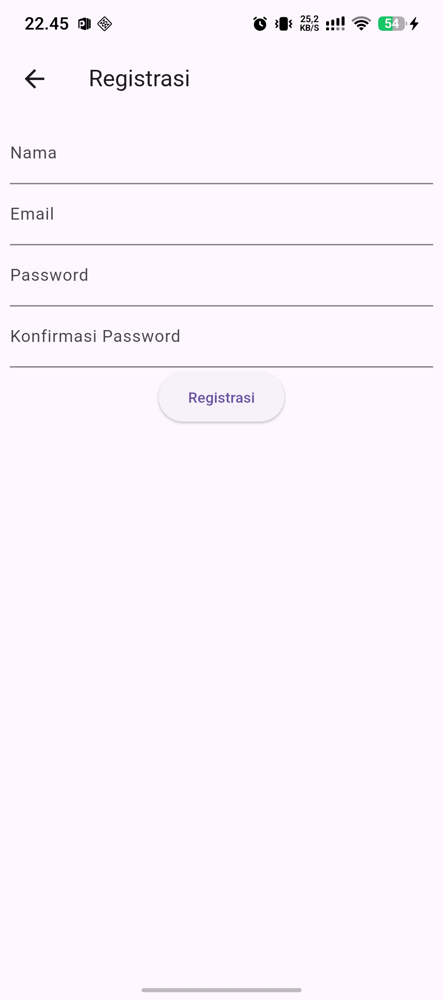
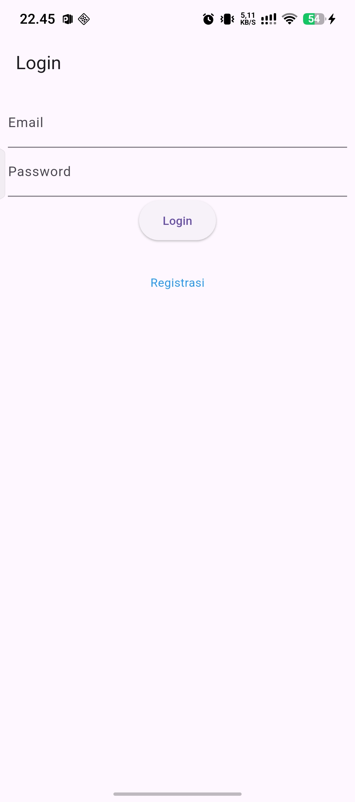
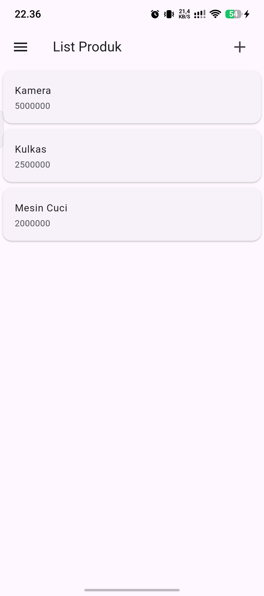
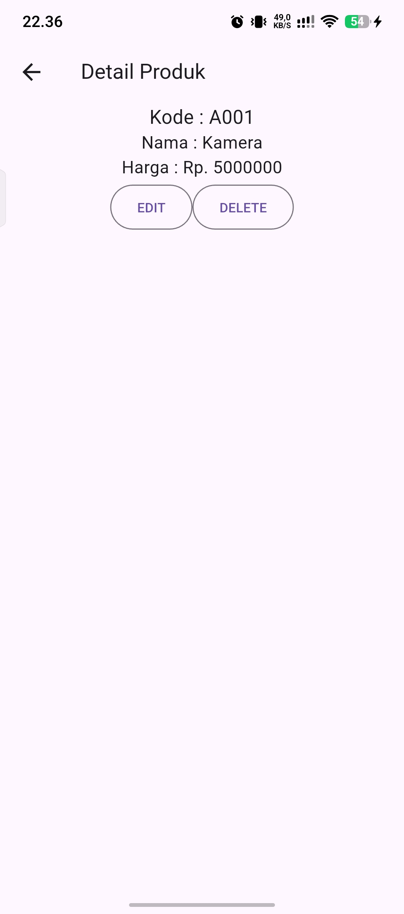
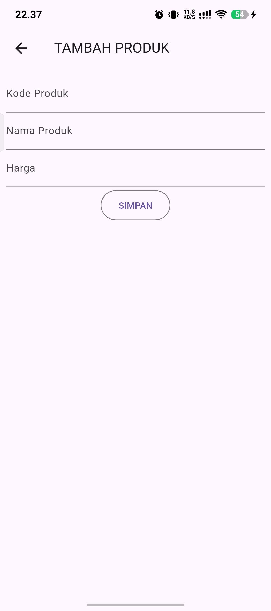
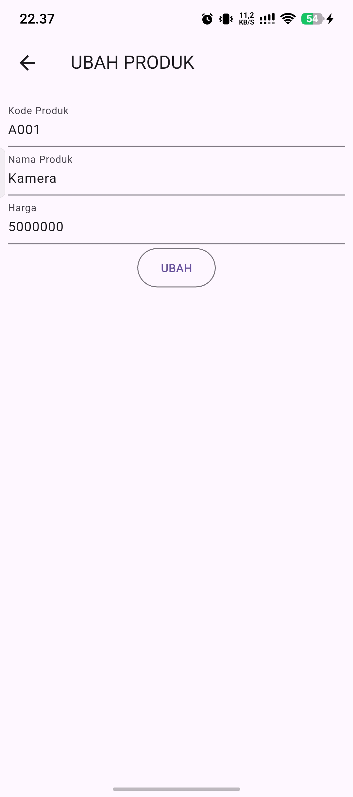

# Laporan Praktikum Pemrograman Mobile

**Nama**        : Ermas Muhammad Syatafa  
**NIM**         : H1D024030  
**Shift**       : Awal A / Akhir C  
**Praktikum**   : Pemrograman Mobile

---

## 📝 Tugas Pertemuan 8

**Tanggal**: Selasa, 10 November 2026

**Kesimpulan Praktikum:**  
Pada pertemuan kedelapan, praktikum membahas operasi CRUD (*Create, Read, Update, Delete*) menggunakan REST API dengan CodeIgniter 4 dan Flutter. Mahasiswa mempelajari pembuatan database, model, controller, serta routing untuk mengelola data. Selain itu, dilakukan pembuatan antarmuka aplikasi Toko Kita yang meliputi halaman login, registrasi, daftar produk, form produk, dan detail produk. Melalui praktikum ini, mahasiswa memperoleh pemahaman mengenai konsep REST API, pertukaran data menggunakan format JSON, serta penerapan struktur aplikasi mobile menggunakan Flutter.